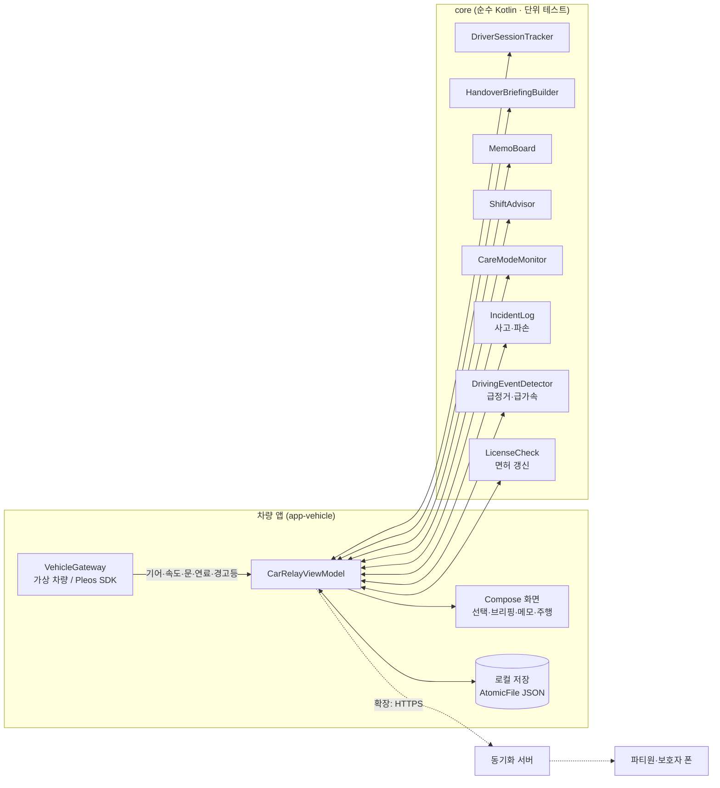

# 카릴레이 (CarRelay)

> 한 대의 차를 가족이 번갈아 쓸 때, **지난 확인 이후 달라진 차량 상태, 아직 해결되지 않은 메모와 사고·파손을 다음 운전자에게 이어 주는** Pleos Connect 인카 앱

현대자동차그룹 차량용 앱 개발 공모전 출품작 · Pleos Connect (Android Automotive OS)

**바로가기**: [실행 방법](#실행-방법) · [테스트 환경 및 필요한 설정](#테스트-환경-및-필요한-설정) · [APK](#apk)

---

## 해결하려는 문제

차는 연료·경고등·주행거리를 알고 있고, 사람은 "와이퍼에서 소리 나요", "저녁에 장거리 써요" 같은 맥락을 알고 있습니다. 운전자가 바뀌는 순간 이 두 정보가 따로 놀아서 다음 운전자가 각각 확인해야 합니다.

카릴레이는 **주차 중 차를 넘겨받는 순간**에 두 정보를 한 화면에 모으고, 확인·해결 결과를 다음 운전자에게 이어 줍니다.

여러 사람이 차를 돌려 쓰면 문제가 하나 더 생깁니다. 급하게 운전했거나 어딘가 긁었는데 말하지 않고 넘기면, 다음 사람이 그대로 떠안고 **언제 생긴 일인지도 알기 어렵습니다.** 그래서 카릴레이는 운행 중 급정거가 있었으면 주차 후 "차에 이상이 있나요?"라고 묻고, 넘겨받는 사람에게는 차를 둘러본 뒤 **확인했어요 / 이상이 있어요** 중 하나를 누르게 합니다. 신고된 사고·파손은 처리가 끝날 때까지 모든 운전자의 브리핑 맨 위에 남습니다.

## 핵심 기능

| 기능 | 내용 | 상태 |
|---|---|---|
| **F2 운전자 선택** | 기어 P에서 프로필 터치 한 번. 선택 없이 출발하면 직전 운전자로 자동 지정하되 **미확인**으로 기록 | ✅ 가상 차량에서 동작 |
| **F3 인수인계 브리핑** | 지난번과 달라진 점(연료 변화·새 경고등·남은 메모·사고·파손)을 중요한 순서대로 **한 줄 문장**으로 화면+음성 안내. 왼쪽에는 차 그림과 숫자 두 개(연료, 갈 수 있는 거리)만 | ✅ |
| **F3 메모** | 주차 후 프리셋 버튼으로 메모. **읽음과 해결을 분리**: 읽어도 해결 전까지 모두에게 남음 | ✅ |
| **F3 인수 점검** | 브리핑 아래 버튼 두 개: **확인했어요** / **이상이 있어요**. 이상을 남기면 직전 운전자와 주차 시각을 함께 기록(원인은 단정하지 않음) | ✅ |
| **F3 사고·파손 신고** | 두 단계: ① 무슨 일(긁힘·찌그러짐 등) ② **차 그림에서 위치**(모르면 건너뛰기). 처리 필요 → 처리 중(수리·보험 맡김) → 처리 완료(다 고쳤어요). 완료 전까지 모든 운전자 브리핑 맨 위에 표시 | ✅ |
| **F5 운행 후 이상 확인** | 모든 운전자의 급정거(3.5m/s² 이상)·급가속(3.0m/s² 이상) 횟수를 운전 구간별로 기록. 주차 후 급정거가 있었으면 "차에 이상이 있나요?" | ✅ 가상 차량 · 실차는 속도 신호 검증 후 |
| **가족 프로필** | 면허 종류·경력, **갱신 D-day**(60일 전부터 표시), 초보 운전(2년 미만), 운전자별 신고·발견 건수. **면허 번호는 저장하지 않음** | ✅ 샘플 데이터 · 입력은 폰 앱(확장) |
| **F4 교대 감지·안내** | 주차 중 운전석 문 열림→닫힘 시 "운전자 바뀌셨나요?" / 연속 2시간·심야 1시간 휴식·교대 권유 | ✅ |
| **F4 오늘의 운전자 추천** | 수면 시간 요약(워치→폰 앱)을 비교해 출발 전 추천 | ✅ 샘플 데이터 |
| **F6 케어 모드** | 본인 동의한 파티원만. 주행 기어 정차·무조작 / 급감속 반복 → "괜찮으세요?" → 무응답 시 쉼터 경유지 → 보호자 알림 | ✅ 로직 · 서버 알림 예정 |
| **F5 운전자별 기록** | 운전자별 주행 횟수·거리·시간·급정거·급가속, 사고·파손 이력, 케어 모드 하루 요약 | ✅ 기초 |
| F1 파티 (폰 앱) | 파티 생성·초대·Health Connect 연동 | 🗓 확장 |
| 동기화 서버 · 보호자 푸시 | 메모·기록을 파티원 폰과 공유 | 🗓 확장 |

> 상태 표시는 저장소 기준입니다. ✅ = 가상 차량 모드에서 흐름 전체가 동작하는 코드가 있음. Pleos 실차 데이터 연동 범위는 아래 [SDK 사용 계획](#pleos-sdk-사용-계획)에 따로 표시합니다.

## 설계 원칙

1. **현재 상태와 '내 마지막 확인'을 함께** 보여 주고, 그 사이 누가 무엇을 했는지는 추정하지 않습니다.
2. **차량 데이터와 사람의 메모를 구분**해 표시합니다(메모는 보라색, "OO의 메모:"로 시작).
3. **메모를 해결해도 차량 경고등은 따로 계속 표시**합니다.
4. **한 번에 필요한 것만**: 중요한 순서대로 한 줄 문장으로 말하고, 특이사항이 없으면 한 줄로 끝냅니다.
5. **지원 안 함·읽기 실패·오래된 값을 숨기지 않습니다.**
6. 주행 중에는 **음성 + 큰 버튼 최대 2개**만(CarUxRestrictions). 주차 중에도 화면마다 **큰 버튼은 2개까지**(주요 1 + 보조 1), 나머지는 글자 버튼.
7. 케어 모드는 **본인 동의로만** 켜지고, 보호자에게는 **하루 요약만**, 위치는 **응답이 없을 때만** 보냅니다. 의료적 표현은 쓰지 않습니다.
8. 사고·파손은 **누구 탓인지 정하지 않습니다.** 언제·어디서 발견됐는지와 직전 운전자만 남기고, **처리 완료 전까지 사라지지 않습니다.**
9. 운전 습관은 **점수나 순위로 만들지 않고** 급정거·급가속 횟수만 보여 줍니다.
10. 개인정보는 필요한 만큼만: **면허 번호(고유식별정보)는 받지도 저장하지도 않습니다.**
11. **4070 가족이 바로 쓰게**: 배지·출처·시각 같은 보조 정보는 빼고 문장으로, 어려운 말(브리핑·미확인·인수 점검) 대신 일상어(달라진 점·확인 필요·확인했어요).

## 구조



```
.
├─ core/                 차량과 무관한 핵심 로직 + 단위 테스트
├─ app-vehicle/          Pleos Connect 차량 앱
│  ├─ src/main/          화면·ViewModel·가상 차량·AAOS Car API
│  ├─ src/simulated/     carrelay.pleosSdk=false 일 때: 가상 차량 연결
│  └─ src/pleos/         carrelay.pleosSdk=true 일 때: Pleos Vehicle SDK 연결
├─ apk/                  제출용 release APK (팀명_CarRelay_release.apk)
└─ docs/                 개발환경 · 아키텍처 · 일정 · 기획 결정 사항
```

## 실행 방법

1. **Android Studio** 최신 버전 설치 → 이 폴더를 열기 → Gradle Sync
2. **Pleos Connect Emulator v2.1.0 (API 34)** AVD 만들기 (Cold boot, RAM 4GB)
3. `app-vehicle` 실행 ▶ → 오른쪽 **가상 차량** 패널로 기어·속도·연료·경고등·문을 바꿔 가며 시연

자세한 순서: [docs/01_개발환경_세팅.md](docs/01_개발환경_세팅.md)

단위 테스트(차량 없이 PC에서): `core/src/test` 우클릭 → Run Tests, 또는 `gradlew.bat :core:test` (현재 41개 통과)

> Windows 사용자 이름이 한글이면 프로젝트를 영문 경로(예: `C:\dev\carrelay`)에 두고 `GRADLE_USER_HOME` 을 영문 경로로 지정해야 빌드됩니다. → [docs/01 0번](docs/01_개발환경_세팅.md#0-windows-사용자-이름이-한글이면-중요)

### 시연 순서 (시나리오 A: 주말 장거리 여행)

1. **딸** 선택 → 확인 → 가상 차량 `D` → `60` → `0` → `P` → 메모 **연료 부족** → 운전 끝내기
2. 가상 차량 연료 **12%**
3. **엄마** 선택 → 브리핑: "연료 12%… 출발 전 주유가 필요해요", "딸의 메모: 연료 부족"
4. `D` → `100` → **연속 주행 +30분** ×4 → "2시간 연속 운전 중이에요… 딸님과 교대하거나 쉬어 가실래요?"
   (샘플 데이터에서 아빠는 컨디션 '휴식 필요'라 교대 후보에서 빠집니다)
5. `0` → `P` → **운전석 문 열고 닫기** → "운전자 바뀌셨나요?" → **아빠** → 브리핑
6. **기록** 화면에서 운전자별 거리·시간 확인

### 시연 순서 (시나리오 B: 할아버지 케어 모드)

1. 설정 → **빠른 판단** 켜기 (15초 정차로 시연)
2. **할아버지** 선택 → `D` → `30` → `0` (D로 정차, 조작 없음)
3. 15초 후 "괜찮으세요?" → **괜찮아요** 또는 무응답
4. 무응답이면 쉼터 경유지 추가(시뮬레이션) → 보호자 알림 기록
5. **기록** 화면에서 하루 요약 확인

### 시연 순서 (시나리오 C: 사고·파손을 그냥 넘기지 않기)

1. **아빠** 선택 → 확인 → `D` → `60` → **급정거** → `0` → `P`
2. "운전 중 급정거가 1번 있었어요. 차에 이상이 있나요?" → **있어요** → ① **긁힘** ② 차 그림에서 **앞·왼쪽** → **남기기**
3. **운전 끝내기** → **엄마** 선택 → 브리핑 맨 위 "앞·왼쪽 긁힘: 아직 고치지 않았어요"
4. 차를 둘러보고 **이상이 있어요** → **찌그러짐 · 뒤** → 직전 운전자(아빠)와 주차 시각이 함께 기록됨
5. 사고 줄의 **처리하기** → **수리·보험 맡겼어요** → 처리 중으로 바뀜 → **확인했어요**
6. **기록** → 사고·파손 이력 · 운전자별 급정거 횟수 / **설정** → 가족 프로필(면허 갱신 20일 남음 · 초보 운전)

## 테스트 환경 및 필요한 설정

### 테스트 환경

| 항목 | 내용 |
|---|---|
| 에뮬레이터 | **Pleos Connect Emulator v2.1.0** (Android 14, API 34) |
| 시스템 이미지 | Pleos Connect v2.1.0 APIs Intel x86_64 Atom System Image |
| AVD 설정 | Form Factor **Automotive** → **Pleos Connect v2.1.0**, Default boot **Cold**, RAM **4 GB** |
| 차량 값 조작 | Pleos Connect Virtual Console, 또는 앱 안의 **가상 차량** 패널 |
| 대체 환경 | 일반 Android Automotive AVD 에서도 가상 차량 모드로 전체 흐름 실행 가능 |
| 네트워크 | 필요 없음 (모든 데이터는 기기에 저장) |

> 현재 검증은 에뮬레이터 기준입니다. 실제 차량에서는 아직 시험하지 않았습니다.

### 빌드 환경

| 항목 | 버전 | 근거 |
|---|---|---|
| Android Studio | 최신 안정판 | Pleos 안내 |
| JDK (Gradle 실행용) | 17~23 (예: JetBrains Runtime 21) | Gradle 8.10.2 지원 범위. Android Studio 내장 JDK 25 는 사용 불가 |
| Gradle / AGP | 8.10.2 / 8.8.2 | 공식 요건 Gradle 8.0 이상 |
| Kotlin | 2.0.0, Jetpack Compose | 공식 요건 Java·Kotlin |
| compileSdk / targetSdk / minSdk | 35 / 35 / **28** | 공식 요건 minSdk 28 이상 (차량 사이버 보안) |
| Vehicle SDK | `ai.pleos.playground:Vehicle:2.3.2` | Pleos 문서 (2026-10-27 확인) |

### 필요한 설정

1. **차량 데이터 모드** (`gradle.properties`, 바꾼 뒤 Gradle Sync)

   | 값 | 차량 데이터 | 용도 |
   |---|---|---|
   | `carrelay.pleosSdk=false` (기본) | 가상 차량 | 어떤 Automotive AVD 에서나 시연 |
   | `carrelay.pleosSdk=true` | Pleos Vehicle SDK + AAOS Car API | Pleos AVD + Virtual Console |

2. **권한**: Pleos 차량 권한(`pleos.car.permission.CAR_DOORS`, `CAR_ENERGY`, `CAR_SAFETY`, `CAR_DRIVE`)은 매니페스트에 선언되어 있어 따로 허용할 필요가 없습니다. SDK 모드로 처음 실행하면 속도 권한(`android.car.permission.CAR_SPEED`)을 묻는데, **허용**을 눌러 주세요.
3. **음성 안내**: Android 기본 TTS(한국어)를 씁니다. 에뮬레이터에 한국어 음성이 없으면 소리 없이 화면으로만 안내합니다. 설정 화면에서 끌 수 있습니다.
4. **시연용 설정**: 설정 → **빠른 판단**을 켜면 케어 모드 안부 확인을 2분 대신 15초 정차로 볼 수 있습니다.
5. 처음 실행하면 시연용 파티(아빠·엄마·딸·할아버지)와 샘플 컨디션 데이터가 들어 있습니다. 설정 → **기록 초기화**로 언제든 처음 상태로 돌릴 수 있습니다.

자세한 설치 순서: [docs/01_개발환경_세팅.md](docs/01_개발환경_세팅.md)

## APK

| 항목 | 내용 |
|---|---|
| 위치 | [`apk/`](apk/) 폴더 · 파일 이름 `팀명_CarRelay_release.apk` |
| 상태 | **제출 전 업로드 예정** (release 서명 빌드) |
| 설치 | AVD 를 켠 뒤 APK 파일을 에뮬레이터 창에 끌어다 놓거나, 아래 명령 실행 |

```bash
adb install apk/팀명_CarRelay_release.apk
```

APK 가 GitHub 파일 용량 제한을 넘으면 [GitHub Releases](../../releases) 에 올리고 여기에 링크를 남깁니다.

## Pleos SDK 사용 계획

| 용도 | API | 상태 |
|---|---|---|
| 주행·정차 판단 | AAOS `CarPropertyManager` GEAR_SELECTION, PERF_VEHICLE_SPEED | 코드 작성됨 · 에뮬레이터 검증 전 |
| 주행 규제 UI | AAOS `CarUxRestrictionsManager` | 코드 작성됨 · 검증 전 |
| 교대 감지 | Vehicle SDK Door `registerDoorPosition` (CAR_DOORS) | 코드 작성됨 · 검증 전 |
| 연료·배터리 | Vehicle SDK Fuel / EvBattery (CAR_ENERGY) | 함수명 확인 후 연결 |
| 경고등·소모품 | Vehicle SDK Safety / Tire (CAR_SAFETY) | 함수명 확인 후 연결 |
| 운전자별 거리·연속 주행 | Vehicle SDK Odometer (CAR_DRIVE) | 함수명 확인 후 연결 (현재는 앱 자체 시계) |
| 케어 모드 무조작 판단 | Vehicle SDK Brake (CAR_DRIVE) | 함수명 확인 후 연결 |
| 급정거·급가속 횟수 | AAOS PERF_VEHICLE_SPEED 속도 변화로 계산 (가속도 센서 대신) | 가상 차량에서 동작 · 실차 검증 전 |
| 쉼터·휴게소 경유지 | NaviHelper SDK | 확장 (현재 시뮬레이션) |
| 보호자 알림의 현재 위치 (케어 모드 3단계에서만) | FusedLocation SDK | 확장 (현재 시뮬레이션) |
| 음성 안내 | TextToSpeech SDK (신청) → 미승인 시 Android 기본 TTS | Android TTS 사용 중 |

모든 Vehicle SDK 호출은 `checkXxxCapabilities` 로 지원 여부를 먼저 확인하고, 미지원이면 브리핑에 "지원하지 않아요"로 표시합니다.

## 일정

| 날짜 | 내용 |
|---|---|
| ~10.31 | 환경 세팅 · SDK 스파이크(실제 값 2~3종 수신 확인) |
| 11.01~11.12 | MVP: 인수인계 전 과정, 주행 제한, 재시작 복원, 케어 모드 |
| 11.13~11.15 | 시연 영상 · 소스 · APK · 기획서 제출 (마감 11.15) |
| 11.24~12.02 | 폰 연동·리포트 보완, 기능 동결, 리허설 |
| 12.03~12.04 | 최종 PT |

체크리스트: [docs/03_개발일정_체크리스트.md](docs/03_개발일정_체크리스트.md)

## 사용한 오픈소스

| 이름 | 용도 | 라이선스 |
|---|---|---|
| [Pretendard](https://github.com/orioncactus/pretendard) 1.3.9 | 앱 글꼴 (Regular·SemiBold·Bold) | SIL Open Font License 1.1 — [third_party/pretendard/LICENSE.txt](third_party/pretendard/LICENSE.txt) |
| Jetpack Compose · AndroidX · kotlinx.serialization · coroutines | UI · 저장 · 비동기 | Apache License 2.0 |

## 문서

- [01 개발환경 세팅](docs/01_개발환경_세팅.md)
- [02 아키텍처](docs/02_아키텍처.md)
- [03 개발 일정 · 체크리스트](docs/03_개발일정_체크리스트.md)
- [04 기획 결정 사항](docs/04_기획_결정사항.md)
- [05 시연 영상 대본](docs/05_시연영상_대본.md)
