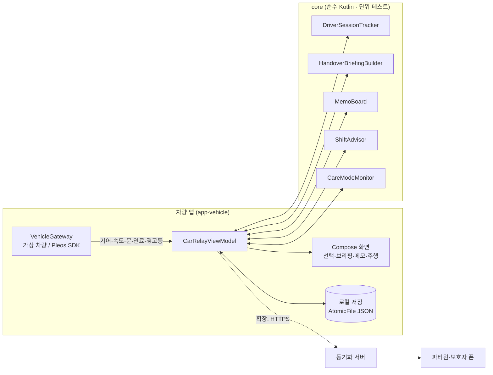

# 카릴레이 (CarRelay)

> 한 대의 차를 가족이 번갈아 쓸 때, **지난 확인 이후 달라진 차량 상태와 아직 해결되지 않은 메모를 다음 운전자에게 이어 주는** Pleos Connect 인카 앱

현대자동차그룹 차량용 앱 개발 공모전 출품작 · Pleos Connect (Android Automotive OS)

---

## 해결하려는 문제

차는 연료·경고등·주행거리를 알고 있고, 사람은 "와이퍼에서 소리 나요", "저녁에 장거리 써요" 같은 맥락을 알고 있습니다. 운전자가 바뀌는 순간 이 두 정보가 따로 놀아서 다음 운전자가 각각 확인해야 합니다.

카릴레이는 **주차 중 차를 넘겨받는 순간**에 두 정보를 한 화면에 모으고, 확인·해결 결과를 다음 운전자에게 이어 줍니다.

## 핵심 기능

| 기능 | 내용 | 상태 |
|---|---|---|
| **F2 운전자 선택** | 기어 P에서 프로필 터치 한 번. 선택 없이 출발하면 직전 운전자로 자동 지정하되 **미확인**으로 기록 | ✅ 가상 차량에서 동작 |
| **F3 인수인계 브리핑** | 내 마지막 확인 대비 연료 변화·새 경고등·남은 메모를 우선순위 상위 3개로 화면+음성 안내 | ✅ |
| **F3 메모** | 주차 후 프리셋 버튼으로 메모. **읽음과 해결을 분리**: 읽어도 해결 전까지 모두에게 남음 | ✅ |
| **F4 교대 감지·안내** | 주차 중 운전석 문 열림→닫힘 시 "운전자 바뀌셨나요?" / 연속 2시간·심야 1시간 휴식·교대 권유 | ✅ |
| **F4 오늘의 운전자 추천** | 수면 시간 요약(워치→폰 앱)을 비교해 출발 전 추천 | ✅ 샘플 데이터 |
| **F6 케어 모드** | 본인 동의한 파티원만. 주행 기어 정차·무조작 / 급감속 반복 → "괜찮으세요?" → 무응답 시 쉼터 경유지 → 보호자 알림 | ✅ 로직 · 서버 알림 예정 |
| **F5 운전자별 기록** | 운전자별 주행 횟수·거리·시간, 케어 모드 하루 요약 | ✅ 기초 |
| F1 파티 (폰 앱) | 파티 생성·초대·Health Connect 연동 | 🗓 확장 |
| 동기화 서버 · 보호자 푸시 | 메모·기록을 파티원 폰과 공유 | 🗓 확장 |

> 상태 표시는 저장소 기준입니다. ✅ = 가상 차량 모드에서 흐름 전체가 동작하는 코드가 있음. Pleos 실차 데이터 연동 범위는 아래 [SDK 사용 계획](#pleos-sdk-사용-계획)에 따로 표시합니다.

## 설계 원칙

1. **현재 상태와 '내 마지막 확인'을 함께** 보여 주고, 그 사이 누가 무엇을 했는지는 추정하지 않습니다.
2. **차량 데이터와 사람의 메모를 구분**해 표시합니다(‘사람이 남긴 정보’ 표시).
3. **메모를 해결해도 차량 경고등은 따로 계속 표시**합니다.
4. **한 번에 필요한 것만**: 상위 3개로 시작하고, 특이사항이 없으면 한 줄로 끝냅니다.
5. **지원 안 함·읽기 실패·오래된 값을 숨기지 않습니다.**
6. 주행 중에는 **음성 + 큰 버튼 최대 2개**만(CarUxRestrictions).
7. 케어 모드는 **본인 동의로만** 켜지고, 보호자에게는 **하루 요약만**, 위치는 **응답이 없을 때만** 보냅니다. 의료적 표현은 쓰지 않습니다.

## 구조



```
.
├─ core/                 차량과 무관한 핵심 로직 + 단위 테스트
├─ app-vehicle/          Pleos Connect 차량 앱
│  ├─ src/main/          화면·ViewModel·가상 차량·AAOS Car API
│  ├─ src/simulated/     carrelay.pleosSdk=false 일 때: 가상 차량 연결
│  └─ src/pleos/         carrelay.pleosSdk=true 일 때: Pleos Vehicle SDK 연결
├─ apk/                  제출용 release APK
└─ docs/                 개발환경 · 아키텍처 · 일정 · 기획 결정 사항
```

## 실행 방법

1. **Android Studio** 최신 버전 설치 → 이 폴더를 열기 → Gradle Sync
2. **Pleos Connect Emulator v2.1.0 (API 34)** AVD 만들기 (Cold boot, RAM 4GB)
3. `app-vehicle` 실행 ▶ → 오른쪽 **가상 차량** 패널로 기어·속도·연료·경고등·문을 바꿔 가며 시연

자세한 순서: [docs/01_개발환경_세팅.md](docs/01_개발환경_세팅.md)

단위 테스트(차량 없이 PC에서): `core/src/test` 우클릭 → Run Tests, 또는 `gradlew :core:test`

### 시연 순서 (시나리오 A: 주말 장거리 여행)

1. **딸** 선택 → 확인 → 가상 차량 `D` → `60` → `0` → `P` → 메모 **연료 부족** → 운전 끝내기
2. 가상 차량 연료 **12%**
3. **엄마** 선택 → 브리핑: "연료 12%… 출발 전 주유가 필요해요", "딸의 메모: 연료 부족"
4. `D` → `100` → **연속 주행 +30분** ×4 → "2시간 연속 운전 중이에요… 딸님과 교대하거나 쉬어 가실래요?"
   (샘플 데이터에서 아빠는 수면 4시간이라 '휴식 필요'로 교대 후보에서 빠집니다)
5. `0` → `P` → **운전석 문 열고 닫기** → "운전자 바뀌셨나요?" → **아빠** → 브리핑
6. **기록** 화면에서 운전자별 거리·시간 확인

### 시연 순서 (시나리오 B: 할아버지 케어 모드)

1. 설정 → **빠른 판단** 켜기 (15초 정차로 시연)
2. **할아버지** 선택 → `D` → `30` → `0` (D로 정차, 조작 없음)
3. 15초 후 "괜찮으세요?" → **괜찮아요** 또는 무응답
4. 무응답이면 쉼터 경유지 추가(시뮬레이션) → 보호자 알림 기록
5. **기록** 화면에서 하루 요약 확인

## 개발 환경

| 항목 | 버전 | 근거 |
|---|---|---|
| Android Studio | 최신 안정판 | Pleos 안내 |
| JDK | 17 이상 (Android Studio 내장 JBR) | Pleos 샘플 앱 기준선 |
| Gradle / AGP | 8.10.2 / 8.8.2 | Pleos 샘플 앱 기준선 |
| Kotlin | 2.0.0, Jetpack Compose | |
| compileSdk / targetSdk / minSdk | 35 / 35 / 28 | minSdk 28: Pleos Playground 배포 조건 |
| 에뮬레이터 | Pleos Connect Emulator v2.1.0 (API 34) | Pleos 안내 |
| Vehicle SDK | `ai.pleos.playground:Vehicle:2.3.2` | Pleos 문서 (2026-10-27 확인) |

## Pleos SDK 사용 계획

| 용도 | API | 상태 |
|---|---|---|
| 주행·정차 판단 | AAOS `CarPropertyManager` GEAR_SELECTION, PERF_VEHICLE_SPEED | 코드 작성됨 · 에뮬레이터 검증 전 |
| 주행 규제 UI | AAOS `CarUxRestrictionsManager` | 코드 작성됨 · 검증 전 |
| 교대 감지 | Vehicle SDK Door `registerDoorPosition` (CAR_DOORS) | 코드 작성됨 · 검증 전 |
| 연료·배터리 | Vehicle SDK Fuel / EvBattery (CAR_ENERGY) | 함수명 확인 후 연결 |
| 경고등·소모품 | Vehicle SDK Safety / Tire (CAR_SAFETY) | 함수명 확인 후 연결 |
| 운전자별 거리·연속 주행 | Vehicle SDK Odometer (CAR_DRIVE) | 함수명 확인 후 연결 (현재는 앱 자체 시계) |
| 케어 모드 무조작 판단 | Vehicle SDK Brake (CAR_DRIVE) | 함수명 확인 후 연결 |
| 쉼터·휴게소 경유지 | NaviHelper SDK | 확장 (현재 시뮬레이션) |
| 음성 안내 | TextToSpeech SDK (신청) → 미승인 시 Android 기본 TTS | Android TTS 사용 중 |

모든 Vehicle SDK 호출은 `checkXxxCapabilities` 로 지원 여부를 먼저 확인하고, 미지원이면 브리핑에 "지원하지 않아요"로 표시합니다.

## 일정

| 날짜 | 내용 |
|---|---|
| ~10.31 | 환경 세팅 · SDK 스파이크(실제 값 2~3종 수신 확인) |
| 11.01~11.12 | MVP: 인수인계 전 과정, 주행 제한, 재시작 복원, 케어 모드 |
| 11.13~11.15 | 시연 영상 · 소스 · APK · 기획서 제출 (마감 11.15) |
| 11.24~12.02 | 폰 연동·리포트 보완, 기능 동결, 리허설 |
| 12.03~12.04 | 최종 PT |

체크리스트: [docs/03_개발일정_체크리스트.md](docs/03_개발일정_체크리스트.md)

## 문서

- [01 개발환경 세팅](docs/01_개발환경_세팅.md)
- [02 아키텍처](docs/02_아키텍처.md)
- [03 개발 일정 · 체크리스트](docs/03_개발일정_체크리스트.md)
- [04 기획 결정 사항](docs/04_기획_결정사항.md)
