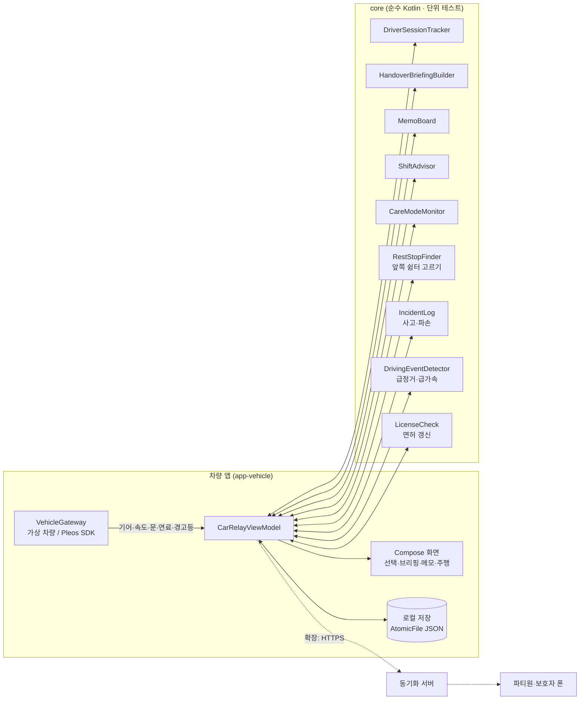

# 카릴레이 (CarRelay)

> 한 대의 차를 가족이 번갈아 쓸 때, **지난 확인 이후 달라진 차량 상태, 아직 해결되지 않은 메모와 사고·파손을 다음 운전자에게 이어 주는** Pleos Connect 인카 앱

현대자동차그룹 차량용 앱 개발 공모전 출품작 · Pleos Connect (Android Automotive OS)

**바로가기**: [실행 방법](#실행-방법) · [테스트 환경 및 필요한 설정](#테스트-환경-및-필요한-설정) · [APK](#apk)

---

## 해결하려는 문제

차는 연료·경고등·주행거리를 알고 있고, 사람은 "와이퍼에서 소리 나요", "저녁에 장거리 써요" 같은 맥락을 알고 있습니다. 운전자가 바뀌는 순간 이 두 정보가 따로 놀아서 다음 운전자가 각각 확인해야 합니다.

카릴레이는 **주차 중 차를 넘겨받는 순간**에 두 정보를 한 화면에 모으고, 확인·해결 결과를 다음 운전자에게 이어 줍니다.

여러 사람이 차를 돌려 쓰면 문제가 하나 더 생깁니다. 급하게 운전했거나 어딘가 긁었는데 말하지 않고 넘기면, 다음 사람이 그대로 떠안고 **언제 생긴 일인지도 알기 어렵습니다.** 그래서 카릴레이는 운행 중 급정거가 있었으면 주차 후 "차에 이상이 있나요?"라고 묻고, 넘겨받는 사람에게는 차를 둘러본 뒤 **확인했어요 / 이상이 있어요** 중 하나를 누르게 합니다. 신고된 사고·파손은 처리가 끝날 때까지 모든 운전자의 브리핑 맨 위에 남습니다.

## 핵심 기능

| 기능 | 내용 | 상태 |
|---|---|---|
| **F2 운전자 선택** | 기어 P에서 프로필 터치 한 번. 선택 없이 출발하면 직전 운전자로 자동 지정하되 **미확인**으로 기록. 화면 왼쪽에는 넘겨받을 차의 상태(차 그림·배터리·갈 수 있는 거리, **누가 언제 주차했는지**, 남은 메모, 처리 안 된 사고), 사람 카드에는 그 사람 색과 **지난 운전**(어제 19:40 · 6.1km), **나에게 온 메모** | ✅ 가상 차량에서 동작 |
| **F3 인수인계 브리핑** | 지난번과 달라진 점(연료 변화·새 경고등·남은 메모·사고·파손)을 중요한 순서대로 **한 줄 문장**으로 화면+음성 안내. 왼쪽에는 차 그림과 숫자 두 개(연료, 갈 수 있는 거리)만. 새 운전자가 타면 먼저 **환영 장면**(그 사람 색 · 인사 · 확인할 것 개수)을 2초 남짓 보여 주고, 차 그림이 브리핑 자리로 이어집니다 | ✅ |
| **F3 메모** | 주차 후 프리셋 버튼으로 메모. **읽음과 해결을 분리**: 읽어도 해결 전까지 모두에게 남음 | ✅ |
| **F3 인수 점검** | 브리핑 아래 버튼 두 개: **확인했어요** / **이상이 있어요**. 이상을 남기면 직전 운전자와 주차 시각을 함께 기록(원인은 단정하지 않음) | ✅ |
| **F3 사고·파손 신고** | 두 단계: ① 무슨 일(긁힘·찌그러짐 등) ② **차 그림에서 위치**(모르면 건너뛰기). 처리 필요 → 처리 중(수리·보험 맡김) → 처리 완료(다 고쳤어요). 완료 전까지 모든 운전자 브리핑 맨 위에 표시 | ✅ |
| **F5 운행 후 이상 확인** | 모든 운전자의 급정거(3.5m/s² 이상)·급가속(3.0m/s² 이상) 횟수를 운전 구간별로 기록. 주차 후 급정거가 있었으면 "차에 이상이 있나요?" | ✅ 가상 차량 · Pleos 에뮬레이터 실제 속도 신호로 검증 (실차는 아직) |
| **가족 프로필** | 면허 종류·경력, **갱신 D-day**(60일 전부터 표시), 초보 운전(2년 미만), 운전자별 신고·발견 건수. **면허 번호는 저장하지 않음** | ✅ 샘플 데이터 · 입력은 폰 앱(확장) |
| **F4 교대 감지·안내** | 주차 중 운전석 문 열림→닫힘 시 "운전자 바뀌셨나요?" / 연속 2시간·심야 1시간 휴식·교대 권유 → **휴게소 추가**를 누르면 진행 방향 앞쪽의 가까운 휴게소를 경유지로 | ✅ (Pleos 빌드는 Pleos 내비 연동) |
| **F4 오늘의 운전자 추천** | 수면 시간 요약(워치→폰 앱)을 비교해 출발 전 추천 | ✅ 샘플 데이터 |
| **F6 케어 모드** | 본인 동의한 파티원만. 주행 기어 정차·무조작 / 급감속 반복 → "괜찮으세요?" → 무응답 시 가까운 졸음쉼터로 **Pleos 내비 안내** → 보호자 알림(현재 주소 포함) | ✅ 로직·내비·위치 · 보호자 폰 전송은 서버 확장 |
| **F5 운전자별 기록** | 운전자별 주행 횟수·거리·시간·급정거·급가속, 사고·파손 이력, 케어 모드 하루 요약 | ✅ 기초 |
| **말로 남기는 메모** | "다음 사람한테 주유하라고 전해 줘" → **"주유해 주세요"**. 받는 사람("엄마한테")과 메모 종류(주유·타이어…)를 알아서 정리하고 "이렇게 남길게요"로 확인. 주행 중에는 큰 버튼 하나 → 5초 뒤 자동 저장 | ✅ Pleos 빌드: SpeechToText 차량 내장 인식 · 가상 빌드: 예시 문장 고르기 |
| **큰 글씨 모드** | 필요한 사람이 고르면 **그 사람이 운전할 때만** 화면 전체(글씨·버튼·간격)가 1.2배로 커짐 | ✅ 샘플: 할아버지 켜짐 |
| **회사 차 모드 · 운행기록부 자동 작성** | 설정 → 차량 용도 **가족 차 / 회사 차**. 회사 차는 인수 점검(확인했어요) 뒤 **운행 목적**(출퇴근 · 일반 업무 · 개인 용무)을 한 번 누르면, 업무용승용차 **운행기록부**(국세청 고시 서식의 사용자 부서·성명, 주행 전·후 계기판 누적거리, 업무용 사용거리)가 **계기판 값으로 자동으로 채워짐**. 업무사용비율 계산, 목적 미입력·운전자 미확인 표시. 사고·파손 신고는 "관리자에게 보고". 케어 모드·컨디션 추천은 회사 차에서 쓰지 않음(직원 감시로 오해되지 않게) | ✅ Pleos 빌드: Odometer `registerDistanceDriven` 로 검증 · 관리자 화면 전송은 서버 확장 |
| F1 파티 (폰 앱) | 파티 생성·초대·Health Connect 연동 | 🗓 확장 |
| 동기화 서버 · 보호자 푸시 | 메모·기록을 파티원 폰과 공유 | 🗓 확장 |

> 상태 표시는 저장소 기준입니다. ✅ = 가상 차량 모드에서 흐름 전체가 동작하는 코드가 있음. Pleos 실차 데이터 연동 범위는 아래 [SDK 사용 계획](#pleos-sdk-사용-계획)에 따로 표시합니다.

## 설계 원칙

1. **현재 상태와 '내 마지막 확인'을 함께** 보여 주고, 그 사이 누가 무엇을 했는지는 추정하지 않습니다.
2. **차량 데이터와 사람의 메모를 구분**해 표시합니다(메모는 보라색, "OO의 메모:"로 시작).
3. **메모를 해결해도 차량 경고등은 따로 계속 표시**합니다.
4. **한 번에 필요한 것만**: 중요한 순서대로 한 줄 문장으로 말하고, 특이사항이 없으면 한 줄로 끝냅니다.
5. **지원 안 함·읽기 실패·오래된 값을 숨기지 않습니다.**
6. 주행 중에는 **음성 + 큰 버튼 최대 2개**만(CarUxRestrictions). 주차 중에도 화면마다 **큰 버튼은 2개까지**(주요 1 + 보조 1), 나머지는 글자 버튼.
7. 케어 모드는 **본인 동의로만** 켜지고, 보호자에게는 **하루 요약만**, 위치는 **응답이 없을 때만** 보냅니다. 의료적 표현은 쓰지 않습니다.
8. 사고·파손은 **누구 탓인지 정하지 않습니다.** 언제·어디서 발견됐는지와 직전 운전자만 남기고, **처리 완료 전까지 사라지지 않습니다.**
9. 운전 습관은 **점수나 순위로 만들지 않고** 급정거·급가속 횟수만 보여 줍니다.
10. 개인정보는 필요한 만큼만: **면허 번호(고유식별정보)는 받지도 저장하지도 않습니다.**
11. **4070 가족이 바로 쓰게**: 배지·출처·시각 같은 보조 정보는 빼고 문장으로, 어려운 말(브리핑·미확인·인수 점검) 대신 일상어(달라진 점·확인 필요·확인했어요).

## 구조



```
.
├─ core/                 차량과 무관한 핵심 로직 + 단위 테스트
├─ app-vehicle/          Pleos Connect 차량 앱
│  ├─ src/main/          화면·ViewModel·가상 차량·AAOS Car API
│  ├─ src/simulated/     carrelay.pleosSdk=false 일 때: 가상 차량 연결
│  └─ src/pleos/         carrelay.pleosSdk=true 일 때: Pleos Vehicle SDK 연결
├─ apk/                  제출용 release APK (팀명_CarRelay_release.apk)
└─ docs/                 개발환경 · 아키텍처 · 일정 · 기획 결정 사항 · 발표 목업(pt/)
```

## 실행 방법

1. **Android Studio** 최신 버전 설치 → 이 폴더를 열기 → Gradle Sync
2. **Pleos Connect Emulator v2.1.0 (API 34)** AVD 만들기 (Cold boot, RAM 4GB)
3. `app-vehicle` 실행 ▶ → 오른쪽 **가상 차량** 패널로 기어·속도·연료·경고등·문을 바꿔 가며 시연

자세한 순서: [docs/01_개발환경_세팅.md](docs/01_개발환경_세팅.md)

단위 테스트(차량 없이 PC에서): `core/src/test` 우클릭 → Run Tests, 또는 `gradlew.bat :core:test` (현재 41개 통과)

> Windows 사용자 이름이 한글이면 프로젝트를 영문 경로(예: `C:\dev\carrelay`)에 두고 `GRADLE_USER_HOME` 을 영문 경로로 지정해야 빌드됩니다. → [docs/01 0번](docs/01_개발환경_세팅.md#0-windows-사용자-이름이-한글이면-중요)

### 시연 순서 (시나리오 A: 주말 장거리 여행)

1. **딸** 선택 → 확인 → 가상 차량 `D` → `60` → `0` → `P` → 메모 **연료 부족** → 운전 끝내기
2. 가상 차량 연료 **12%**
3. **엄마** 선택 → 브리핑: "연료 12%… 출발 전 주유가 필요해요", "딸의 메모: 연료 부족"
4. `D` → `100` → **연속 주행 +30분** ×4 → "2시간 연속 운전 중이에요… 딸님과 교대하거나 쉬어 가실래요?"
   (샘플 데이터에서 아빠는 컨디션 '휴식 필요'라 교대 후보에서 빠집니다)
5. `0` → `P` → **운전석 문 열고 닫기** → "운전자 바뀌셨나요?" → **아빠** → 브리핑
6. **기록** 화면에서 운전자별 거리·시간 확인

### 시연 순서 (시나리오 B: 할아버지 케어 모드)

1. 설정 → **빠른 판단** 켜기 (15초 정차로 시연)
2. **할아버지** 선택 → `D` → `30` → `0` (D로 정차, 조작 없음)
3. 15초 후 "괜찮으세요?" → **괜찮아요** 또는 무응답
4. 무응답이면 쉼터 경유지 추가(시뮬레이션) → 보호자 알림 기록
5. **기록** 화면에서 하루 요약 확인

### 시연 순서 (시나리오 C: 사고·파손을 그냥 넘기지 않기)

1. **아빠** 선택 → 확인 → `D` → `60` → **급정거** → `0` → `P`
2. "운전 중 급정거가 1번 있었어요. 차에 이상이 있나요?" → **있어요** → ① **긁힘** ② 차 그림에서 **앞·왼쪽** → **남기기**
3. **운전 끝내기** → **엄마** 선택 → 브리핑 맨 위 "앞·왼쪽 긁힘: 아직 고치지 않았어요"
4. 차를 둘러보고 **이상이 있어요** → **찌그러짐 · 뒤** → 직전 운전자(아빠)와 주차 시각이 함께 기록됨
5. 사고 줄의 **처리하기** → **수리·보험 맡겼어요** → 처리 중으로 바뀜 → **확인했어요**
6. **기록** → 사고·파손 이력 · 운전자별 급정거 횟수 / **설정** → 가족 프로필(면허 갱신 20일 남음 · 초보 운전)

### 시연 순서 (말로 남기는 메모 · 큰 글씨)

1. **아빠** 선택 → **메모 남기기** → **말로 남기기**
   - Pleos 빌드: "엄마한테 타이어 바람 넣으라고 전해 줘"라고 말하기 (에뮬레이터는 마이크 켜기: [docs/01 5번](docs/01_개발환경_세팅.md#pleos-sdk-빌드와-virtual-console-1029-검증-완료))
   - 가상 빌드: 같은 예시 문장을 누르기
2. "이렇게 남길게요 · 엄마에게 · 타이어 바람 넣어 주세요" → **남기기** → 홈에 마이크 표시 메모
3. **운전 끝내기** → **할아버지** 선택 → 화면 전체가 크게 → 브리핑 "아빠가 엄마에게 남긴 메모: 타이어 바람 넣어 주세요"
4. `D` → **말로 메모 남기기** → 5초 뒤 자동 저장(버튼을 누르지 않아도 됨)
5. **설정** → 가족 프로필의 **큰 글씨** 켜고 끄기

### 시연 순서 (시나리오 D: 회사 차 · 운행기록부 자동 작성)

1. (Pleos 빌드) Virtual Console 에서 Odometer 를 12,480km 처럼 올려 둡니다(새 가상 차량은 0km). 가상 빌드는 12,345km 로 시작합니다
2. **설정** → 차량 용도 **회사 차** → 바꾸기 → 직원 4명(부서 표시)과 지난 이틀 운행 4건이 생김
3. **이 대리** 선택 → 브리핑에 "이 대리의 메모: 하이패스 카드 잔액이 얼마 안 남았어요" → **확인했어요** → "어떤 일로 운행하세요?" → **일반 업무**
4. 위쪽에 "회사 차 · 일반 업무" 표시 → `D` → 주행(콘솔 Odometer +12.6km) → `P` → **운전 끝내기**
5. **기록** → 운행기록부에 "이 대리 · 영업1팀 · 12,480.0 → 12,492.6 · 12.6km · 일반 업무"가 자동으로 적히고, 총 주행·업무용 사용거리·**업무사용비율**이 다시 계산됨
6. **설정** → 회사 차에서는 케어 모드·컨디션 추천을 쓰지 않는다는 안내 / 직원 프로필(면허 갱신 25일 남음)

## 테스트 환경 및 필요한 설정

### 테스트 환경

| 항목 | 내용 |
|---|---|
| 에뮬레이터 | **Pleos Connect Emulator v2.1.0** (Android 14, API 34) |
| 시스템 이미지 | Pleos Connect v2.1.0 APIs Intel x86_64 Atom System Image |
| AVD 설정 | Form Factor **Automotive** → **Pleos Connect v2.1.0**, Default boot **Cold**, RAM **4 GB** |
| 차량 값 조작 | Pleos Connect Virtual Console, 또는 앱 안의 **가상 차량** 패널 |
| 대체 환경 | 일반 Android Automotive AVD 에서도 가상 차량 모드로 전체 흐름 실행 가능 |
| 네트워크 | 필요 없음 (모든 데이터는 기기에 저장) |

> 현재 검증은 에뮬레이터 기준입니다. 실제 차량에서는 아직 시험하지 않았습니다.

### 빌드 환경

| 항목 | 버전 | 근거 |
|---|---|---|
| Android Studio | 최신 안정판 | Pleos 안내 |
| JDK (Gradle 실행용) | 17~23 (예: JetBrains Runtime 21) | Gradle 8.10.2 지원 범위. Android Studio 내장 JDK 25 는 사용 불가 |
| Gradle / AGP | 8.10.2 / 8.8.2 | 공식 요건 Gradle 8.0 이상 |
| Kotlin | 2.0.0, Jetpack Compose | 공식 요건 Java·Kotlin |
| compileSdk / targetSdk / minSdk | 35 / 35 / **28** | 공식 요건 minSdk 28 이상 (차량 사이버 보안) |
| Vehicle SDK | `ai.pleos.playground:Vehicle:2.3.2` | Pleos 문서 (2026-10-27 확인) |

### 필요한 설정

1. **차량 데이터 모드** (`gradle.properties`, 바꾼 뒤 Gradle Sync)

   | 값 | 차량 데이터 | 용도 |
   |---|---|---|
   | `carrelay.pleosSdk=false` (기본) | 가상 차량 | 어떤 Automotive AVD 에서나 시연 |
   | `carrelay.pleosSdk=true` | Pleos Vehicle SDK + AAOS Car API | Pleos AVD + Virtual Console |

2. **권한**: Pleos 차량 권한(`pleos.car.permission.CAR_DOORS`, `CAR_ENERGY`, `CAR_SAFETY`, `CAR_DRIVE`)은 매니페스트에 선언되어 있어 따로 허용할 필요가 없습니다. SDK 모드로 처음 실행하면 속도 권한(`android.car.permission.CAR_SPEED`)을 묻는데, **허용**을 눌러 주세요.
3. **음성 안내**: Android 기본 TTS(한국어)를 씁니다. 에뮬레이터에 한국어 음성이 없으면 소리 없이 화면으로만 안내합니다. 설정 화면에서 끌 수 있습니다.
4. **시연용 설정**: 설정 → **빠른 판단**을 켜면 케어 모드 안부 확인을 2분 대신 15초 정차로 볼 수 있습니다.
5. 처음 실행하면 시연용 파티(아빠·엄마·딸·할아버지)와 샘플 컨디션 데이터가 들어 있습니다. 설정 → **기록 초기화**로 언제든 처음 상태로 돌릴 수 있습니다.

자세한 설치 순서: [docs/01_개발환경_세팅.md](docs/01_개발환경_세팅.md)

## APK

| 항목 | 내용 |
|---|---|
| 파일 | [`apk/CarRelay_release.apk`](apk/) **Pleos SDK 빌드** (17.7MB) · [`apk/CarRelay_virtual_release.apk`](apk/) 가상 차량 빌드 (9.6MB) |
| 상태 | ✅ release 서명 빌드 **v1.1.0** (2026-11-03, 회사 차 모드·운행기록부 추가) · Pleos Connect Emulator v2.1.0 에서 설치·실행 확인 · 제출 때 파일 이름 앞에 팀명을 붙입니다 (`팀명_CarRelay_release.apk`) |
| 어떤 것을 | Pleos Connect Emulator + Virtual Console 로 실제 SDK 연동을 보려면 **CarRelay_release.apk**, 콘솔 없이 앱 안의 **가상 차량** 패널로 전체 흐름을 보려면 **CarRelay_virtual_release.apk** |
| 설치 | AVD 를 켠 뒤 APK 파일을 에뮬레이터 창에 끌어다 놓거나, 아래 명령 실행 (두 파일은 같은 앱이라 하나만 설치) |

```bash
adb install apk/CarRelay_release.apk
```

APK 가 GitHub 파일 용량 제한을 넘으면 [GitHub Releases](../../releases) 에 올리고 여기에 링크를 남깁니다.

## Pleos SDK 연동 (2026-10-29 에뮬레이터에서 검증)

`carrelay.pleosSdk=true` 빌드를 **Pleos Connect Emulator v2.1.0** 에 설치하고, **Pleos Connect Virtual Console** 로 차량 값을 바꿔 앱이 반응하는지 확인했습니다. 함수 이름은 SDK 아카이브(`Vehicle-2.3.2.aar`)의 실제 클래스에서 확인했습니다.

| 신호 | API (Vehicle SDK 2.3.2) | 상태 |
|---|---|---|
| 배터리 잔량 | EvBattery `registerEvBatteryStateOfCharge` | ✅ 콘솔에서 64% → 12% 로 바꾸면 홈 화면이 바로 바뀜 |
| 주행 가능 거리 | Odometer `registerRangeRemainingListener` | ✅ 423km → 61km (Pleos 계기판과 같은 값) |
| 기어 | Gear `registerGearSelection` | ✅ D → 주행 화면, P → "주차하셨네요. 남길 말이 있나요?" |
| 운전석 문 | Door `registerDoorPosition(DoorArea(ROW_1_LEFT))` | ✅ 열림 → 닫힘 → "운전하는 분이 바뀌었나요?" |
| 주행 규제 UI | AAOS `CarUxRestrictionsManager` | ✅ D에서 주행 화면. P로 바꾼 뒤 제한이 조금 늦게 풀리는 것을 발견해 처리 |
| 속도 | AAOS `PERF_VEHICLE_SPEED` (`CAR_SPEED` 권한) | ✅ 콘솔 가속 페달을 누르고 있으면 0 → 108km/h 가 초당 5번 들어옴 |
| 브레이크 페달 (케어 모드) | Brake `registerBrakePedalStatus` | ✅ 콘솔 브레이크를 밟고 떼면 눌림/뗌이 들어옴 |
| 누적 주행거리 | Odometer `registerDistanceDriven` | ✅ 콘솔 Odometer 0 → 423,280km 가 그대로 들어옴 (단위 km) |
| **운행기록부 (회사 차)** | 위 누적 주행거리 + 운전자 선택 + 운행 목적 | ✅ (11/03) 콘솔 Odometer 12,480.0 → 12,492.6km 로 바꾸며 주행 → 운행기록부에 "이 대리 · 12,480.0 → 12,492.6 · 12.6km · 일반 업무"가 자동으로 적히고 업무사용비율이 다시 계산됨 |
| **급정거 → 운행 후 이상 확인** | 위 속도 신호로 계산 | ✅ 96km/h 에서 브레이크를 꾹 밟으면 급정거 1회 → P 에서 "운전 중 급정거가 1번 있었어요. 차에 이상이 있나요?" |
| 연료 (내연기관차) | Fuel `registerFuelPercent` | 구독 확인 · 에뮬레이터는 전기차라 값 변화는 미확인 |
| 엔진오일·브레이크액·워셔액 | Safety `registerEngineOilLevelState` 등 (`CAR_SAFETY`) | 구독 확인 · 콘솔에 조작 항목 없음 |
| 계기판 경고등 (telltale) | Safety `registerTelltales` | ❌ `PRIVATE_CAR_SAFETY` 권한이 필요해 서드파티 앱은 못 받음 → 브리핑에 "경고등 정보: 이 앱에서는 볼 수 없어요"로 알리고, "경고등 없음"이라고 말하지 않음 |
| 타이어 공기압 값 | Tire `registerTirePressure` | ❌ `PRIVATE_CAR_SAFETY` 필요 → 쓰지 않음 |
| **휴게소·졸음쉼터 안내** (교대 권유 · 케어 모드 2단계) | NaviHelper 3.0.5 `requestRoute` / `addWaypoint` | ✅ 케어 모드 무응답 → Pleos 내비가 **성남졸음쉼터(6.3km, 14분)** 로 안내 시작. 목적지가 있으면 첫 번째 경유지로 추가(`onWaypointChanged` ADD 확인) |
| 현재 위치 (쉼터 고르기 · 보호자 알림) | NaviHelper `getCurrentLocationInfo` → FusedLocation 1.1.3 | ✅ 보호자 알림에 "위치: 수정구 시흥동" (내비 주소). FusedLocation 은 연결했지만 에뮬레이터에서는 안드로이드 기본 GPS 를 돌려줘 내비 위치를 먼저 씀 |
| **말로 남기는 메모** | SpeechToText 3.3.1 `ON_DEVICE` (`initialize` → `request` → `onUpdated`) | ✅ 차량 내장 인식 엔진이 한국어를 받아씀: "엄마한테 타이어 바람 넣으라고 전해줘" → 메모 "엄마에게 · 타이어 바람 넣어 주세요". ON_DEVICE 는 앱 등록(Client ID) 없이 동작. 에뮬레이터에서는 마이크 대신 `sendAudio` 로 한국어 음성 파일을 넣어 확인. 합성 음성의 "주유"를 "주의"로 들은 적이 있어 저장 전에 꼭 확인 화면을 거침 |
| 음성 안내 | TextToSpeech SDK | 확장 (현재 Android 기본 TTS) |

값을 바꾸면 SDK 리스너가 알려 주고, 앱은 주기 갱신을 기다리지 않고 곧바로 다시 읽어 화면에 반영합니다.

NaviHelper 에는 주변 검색 API 가 없어, 쉼터 좌표는 앱에 넣은 OpenStreetMap 목록에서 진행 방향 앞쪽(±60°)의 가장 가까운 곳을 고른 뒤 내비에 넘깁니다.

> **주행 중 화면 제한:** 앱은 `distractionOptimized` 를 선언하고 주행 중 화면을 따로 두지만, adb 로 설치한 앱은 시스템의 주행 중 허용 목록에 없어, 에뮬레이터에서 기어가 D 일 때 앱을 새로 띄우면 시스템이 "주행 중에는 사용할 수 없습니다"로 가릴 수 있습니다. 시연할 때는 콘솔 기어를 P 로 두고 앱을 먼저 띄운 뒤 D 로 바꿉니다. 정식 배포(Pleos App Market)에서는 심사를 거쳐 허용 목록에 오릅니다.

### Pleos 빌드로 실행하기 (Virtual Console)

```bash
gradlew.bat :app-vehicle:assembleDebug "-Pcarrelay.pleosSdk=true"
```

```bash
adb install -r app-vehicle/build/outputs/apk/debug/app-vehicle-debug.apk
```

```bash
adb forward tcp:8088 tcp:8088
```

PC 브라우저에서 `http://127.0.0.1:8088/` → **Emulation Controls** → `Energy`(Battery SOC, Remaining Range) / `Motion`(Gear Selection, Brake Pedal, Odometer) / `All domains`(Door Position)을 바꿉니다. 달리려면 기어 D 에서 첫 화면의 **ACCEL** 을 누르고 있고, 급정거는 **BRAKE** 를 꾹 누릅니다. PowerShell 에서는 `-P` 옵션을 따옴표로 감싸야 합니다.

## 일정

| 날짜 | 내용 |
|---|---|
| ~10.31 | 환경 세팅 · SDK 스파이크(실제 값 2~3종 수신 확인) |
| 11.01~11.12 | MVP: 인수인계 전 과정, 주행 제한, 재시작 복원, 케어 모드 |
| 11.13~11.15 | 시연 영상 · 소스 · APK · 기획서 제출 (마감 11.15) |
| 11.24~12.02 | 폰 연동·리포트 보완, 기능 동결, 리허설 |
| 12.03~12.04 | 최종 PT |

체크리스트: [docs/03_개발일정_체크리스트.md](docs/03_개발일정_체크리스트.md)

## 사용한 오픈소스

| 이름 | 용도 | 라이선스 |
|---|---|---|
| [Pretendard](https://github.com/orioncactus/pretendard) 1.3.9 | 앱 글꼴 (Regular·SemiBold·Bold) | SIL Open Font License 1.1 — [third_party/pretendard/LICENSE.txt](third_party/pretendard/LICENSE.txt) |
| Jetpack Compose · AndroidX · kotlinx.serialization · coroutines | UI · 저장 · 비동기 | Apache License 2.0 |
| [OpenStreetMap](https://www.openstreetmap.org/copyright) 데이터 | 전국 휴게소·졸음쉼터 1,004곳 이름·좌표 (`assets/rest_stops.json`) | © OpenStreetMap contributors, ODbL 1.0 — [third_party/openstreetmap/NOTICE.txt](third_party/openstreetmap/NOTICE.txt) |

## 문서

- [01 개발환경 세팅](docs/01_개발환경_세팅.md)
- [02 아키텍처](docs/02_아키텍처.md)
- [03 개발 일정 · 체크리스트](docs/03_개발일정_체크리스트.md)
- [04 기획 결정 사항](docs/04_기획_결정사항.md)
- [05 시연 영상 대본](docs/05_시연영상_대본.md)
- [발표용 목업: 가족 폰 앱 · 법인차 관리 화면](docs/pt/README.md) (확장 예정 화면)
