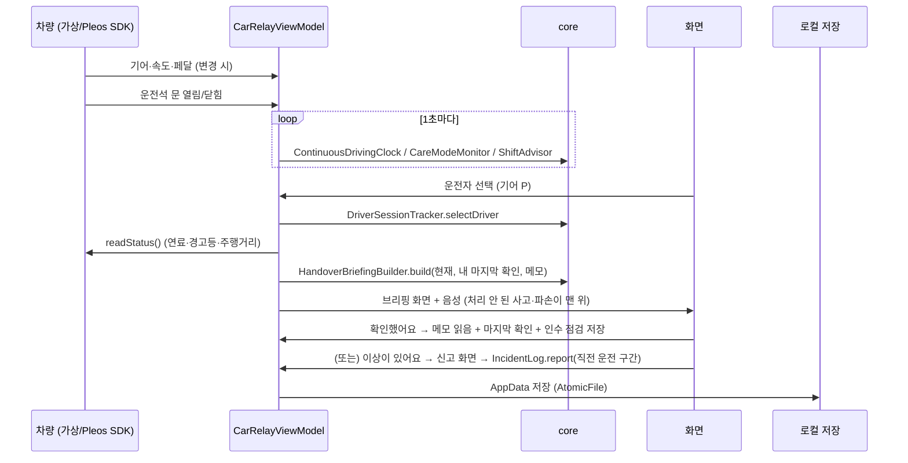
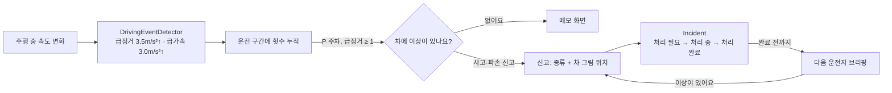
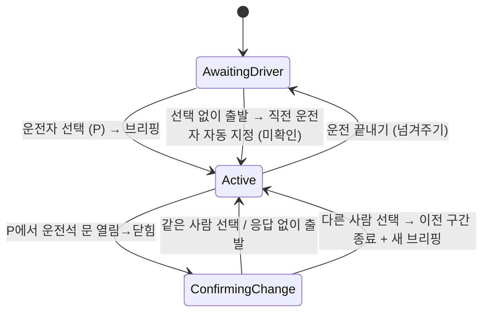
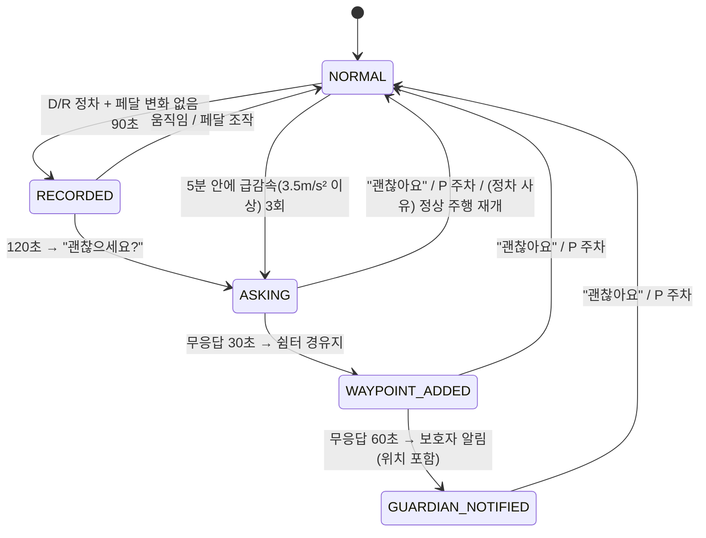

# 02. 아키텍처

## 모듈

| 모듈 | 역할 | 의존 |
|---|---|---|
| `core` | 인수인계 브리핑, 메모 상태, 운전자 세션, 연속 주행·교대 권유, 케어 모드 판단, 사고·파손 기록(`IncidentLog`), 급정거·급가속 감지(`DrivingEventDetector`), 면허 갱신·초보 판단(`LicenseCheck`). 안드로이드·차량에 의존하지 않음 | kotlinx-serialization |
| `app-vehicle` | Pleos Connect 차량 앱. 차량 신호 수집, 화면(Compose), 로컬 저장, 음성 | core, AndroidX, (선택) Pleos Vehicle SDK |
| (확장) `app-phone` | 파티 생성·초대, Health Connect 수면·심박 요약 업로드, 보호자 알림 수신 | |
| (확장) 서버 | 파티·메모·운행 기록·컨디션 요약·케어 이벤트 동기화, 보호자 푸시 | BaaS |

판단 로직을 `core` 에 모은 이유: 차량 없이 PC에서 단위 테스트로 검증할 수 있고, 같은 규칙을 폰 앱·서버에서도 재사용할 수 있습니다.

## 데이터 흐름



## 사고·파손 흐름



- 인수 점검에서 발견하면 직전 운전 구간의 운전자와 주차 시각을 함께 남깁니다. 같은 사람이 이어서 탔으면 남기지 않습니다.
- 원인을 판정하지 않습니다. 화면에는 "직전 운전: ○○ — 확인이 필요해요"까지만 보여 줍니다.
- 급정거 계산은 케어 모드와 같이 차량에서 온 실제 샘플 사이에서만 합니다(1초 타이머 샘플 제외).

## 운전자 세션 상태



## 케어 모드 판단



- 실시간 판단에는 차량 신호만 씁니다. 워치 데이터는 동기화 지연이 있어 **출발 전 컨디션 참고**에만 씁니다.
- 임계값은 `CareModeMonitor.Config` 에 모여 있습니다. 시연 테스트 후 조정하고, 이후 본인의 평소 2주 패턴을 기준선으로 바꿉니다.
- 설정의 **빠른 판단**은 시연용으로 10초/15초/10초/10초를 씁니다.
- 급감속은 차량에서 온 실제 샘플 사이에서만 계산합니다(화면 타이머가 넣는 샘플은 제외해 오경보 방지).

## 차량 데이터 계층

```
VehicleGateway (interface)
 ├─ FakeVehicleGateway     가상 차량: 0.2초마다 현실적인 가감속(2.5m/s², 급감속 7.5m/s²), 주행거리·연료 갱신
 └─ PleosVehicleGateway    Pleos Vehicle SDK(Door, Fuel, Safety, Odometer, Brake) + AaosCarSignals(기어·속도)
UxRestrictionMonitor        AAOS CarUxRestrictionsManager → 주행 중 화면 전환
```

- 빌드 옵션 `carrelay.pleosSdk` 에 따라 `src/simulated` 또는 `src/pleos` 의 `VehicleGatewayProvider` 가 컴파일됩니다.
- 모든 값에는 받은 시각이 붙고, 5분이 지나면 브리핑에 "N분 전 값이에요"로 알립니다.
- 지원하지 않거나 읽지 못한 신호는 `VehicleSnapshot.unavailable` 에 이유와 함께 담깁니다.

## 저장

- `AppData` 하나를 JSON으로 `filesDir/carrelay.json` 에 저장합니다(`AtomicFile` 로 쓰기 도중 종료돼도 깨지지 않음).
- 진행 중인 운전 구간(`activeSession`)도 저장해 앱이 재시작돼도 이어집니다.
- 확장 단계에서 건강 요약 등 민감정보를 다루면 Android Keystore 암호화를 적용합니다.

## 주행 중 화면 규칙

- `CarUxRestrictions.requiresDistractionOptimization` 이 true 이거나 기어가 D/R 이면 주행 화면으로 전환합니다.
- 주행 화면: 큰 글씨 한두 줄 + 버튼 최대 2개. 운전자 선택·메모 입력은 숨깁니다.
- 매니페스트의 `distractionOptimized=true` 는 주행 중에도 앱을 유지하기 위한 것이며, 그만큼 위 규칙을 앱이 지켜야 합니다.

## 아직 검증하지 않은 것

| 항목 | 확인 방법 |
|---|---|
| Pleos SDK 세부 import 경로, Fuel/Safety/Odometer/Brake 함수명 | API Reference + 컴파일 |
| registerDoorPosition 이 운전석(ROW_1_LEFT)만 받는지, area 인자가 필요한지 | Virtual Console 로 문 조작 |
| 서드파티 앱의 CAR_SPEED 권한 허용 여부 | Pleos AVD 에서 권한 요청 |
| 시동·문 열림 시 자동 실행 허용 조건 | 10/28 설명회 질문 |
| Android 기본 TTS 의 한국어 음성 유무 (Pleos AVD) | AVD 에서 실행 |
